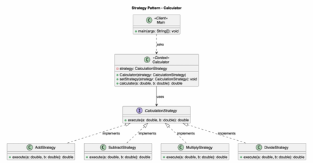
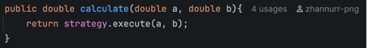
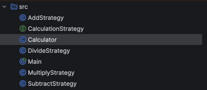
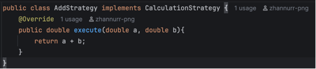
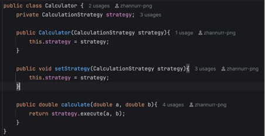
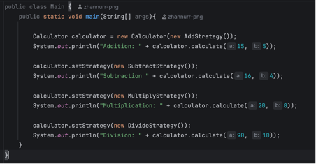

Zhannur Bakyt SE-2524\
Strategy Pattern
1.	Introduction.\
      This project implements the Strategy behavioral design pattern in Java using a calculator as the chosen problem domain. The purpose of the project is to demonstrate how different arithmetic operations can be encapsulated into separate strategies behind a common interface.
      The algorithm family consists of 4 arithmetic operations: addition, subtraction, multiplication and division. Each operation is implemented in a separate strategy classes that implements common interface, allowing the calculator to switch between operation at runtime.
2.	UML diagram.

Strategy interface: CalculationStrategy;
Concrete Strategies: AddStrategy, SubtractStrategy, MultiplyStrategy, DivideStrategy;
Context: Calculator;
Client: Main.

3.	Clean Code.\
3.1	Prefer polymorphism than conditional logic.\
Robert Martin recommends to use polymorphism over if/else statements when different behaviors can be represented by separate implementations.
\
The calculator delegates the calculation to the selected strategy instead of checking the operation time every time.\
3.2	Meaningful names.\
Names should clearly show the purpose of classes, methods and variables.\
\
For example MultiplyStrategy clearly identifies the operation type.\
3.3	Single responsibility.\
Each class should have one clear responsibility.
\
Each concrete strategy implements only one arithmetic operation. For example AddStrategy erforms addition.\
3.4	Encapsulation.\
A class should hide the implementation details and expose only the functionality required by other classes.
\
The Calculator works with the CalculationStrategy rather than depending on specific arithmetic implementations.\
3.5	Easy extensibility.\
The design should allow new behavior to be added with the minimal changes to existing classes.\
\
A new arithmetic operation can be introduced by implementing CalculationStrategy. And client only needs to select the new strategy.
4.	Strategy vs State.
      The strategy pattern is more suitable for this project because it can perform different classes for every arithmetic opertions, so we can switch between them whenever we need. While the State pattern is used when an object behavior changes depending on its current state. Our calculator doesn’t need to manage different states, it simply to choose which operation to perform.

5.	Conclusion.
      The Strategy pattern made the calculator more flexible by allowing different arithmetic operations to be added and switched at runtime. Although the design requires additional classes for each operation, it keeps the code organized and makes it easier to extend and maintain. A new operation can be added without modifying the existing Calculator class. Therefore, the flexibility and maintainability gained outweigh the cost of having more classes.
6.	Repository link: https://github.com/zhannurr-png/strategy-pattern-assignment.git
